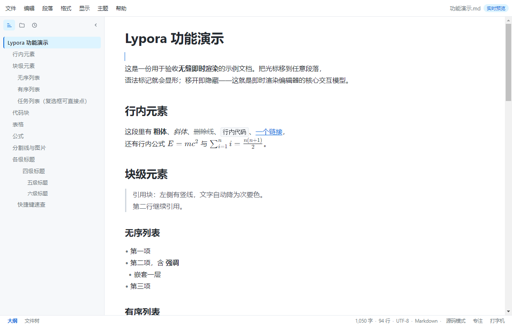

<p align="center"></p>

# Lypora

**An instant-render Markdown editor for Windows, macOS, Linux, the browser and Android — one TypeScript core, five builds.**

[English](#english) · [简体中文](#简体中文)



> **v0.8.2** — The mark changed. Every icon in every build — the Windows `.exe`, the macOS `.icns`, the eight
> Linux hicolor sizes, the Android mipmaps and splash screens, the browser favicon and the PWA icons — is now
> derived from a single source drawing: a terracotta warrior in a space suit. `tools/gen-icons.py` turns that one
> JPEG into 40-odd files, so the next change is one command instead of five manual edits. Why that image, and what
> it has to do with a text editor: [The mark](#the-mark-a-terracotta-warrior-in-orbit).
> Verified by pulling the icons back out of each packaged artefact: all seven sizes found inside `Lypora.exe`,
> eleven frames inside the macOS `Lypora.icns`, the APK's own mipmaps and splash re-extracted and inspected, and
> the Linux 16–512 hicolor set checked against the source.
> Android 10+: [`apk`](https://github.com/dr-bing-li/lypora/releases/download/v0.8.2/Lypora-0.8.2-android.apk) ·
> Windows x64: [`zip`](https://github.com/dr-bing-li/lypora/releases/download/v0.8.2/Lypora-0.8.2-win-x64.zip) ·
> macOS: [`arm64`](https://github.com/dr-bing-li/lypora/releases/download/v0.8.2/Lypora-0.8.2-macos-arm64.tar.gz) / [`x64`](https://github.com/dr-bing-li/lypora/releases/download/v0.8.2/Lypora-0.8.2-macos-x64.tar.gz) ·
> Linux: [`deb`](https://github.com/dr-bing-li/lypora/releases/download/v0.8.2/lypora_0.8.2_amd64.deb) / [`rpm`](https://github.com/dr-bing-li/lypora/releases/download/v0.8.2/lypora-0.8.2-1.x86_64.rpm) /
> [`AppImage`](https://github.com/dr-bing-li/lypora/releases/download/v0.8.2/Lypora-0.8.2-linux-x64.AppImage) / [`tar.gz`](https://github.com/dr-bing-li/lypora/releases/download/v0.8.2/Lypora-0.8.2-linux-x64.tar.gz) ·
> [all releases](https://github.com/dr-bing-li/lypora/releases)

```bash
# 1. build the core
cd core && npm install && npm run build

# 2. run it locally
npm run preview        # http://127.0.0.1:4173
```

### Deployment

**A. Browser / PWA (any static host)**

```bash
cd core && npm run build
# upload the contents of core/dist to GitHub Pages, Netlify, Cloudflare Pages,
# an nginx directory, or anything else that serves static files
```

`core/dist` is a plain static bundle with a service worker and a web manifest — no server-side routing and no
backend required. Serving it over HTTPS gives you installable PWA behaviour and offline caching.

**B. Windows portable build**

```bash
node tools/pack-win.mjs --zip
# -> release/Lypora/Lypora.exe           double-click to run
# -> release/Lypora-0.8.2-win-x64.zip    ready to hand out
```

Requires `desktop/node_modules/electron/dist` (`npm install` inside `desktop/` downloads it). The packer also
stamps the icon and version metadata into the executable.

**C. macOS (Apple Silicon and Intel)**

```bash
# official prebuilt Electron binaries — no npm install involved
curl -LO https://github.com/electron/electron/releases/download/v33.4.11/electron-v33.4.11-darwin-arm64.zip
python tools/pack-mac.py --zip electron-v33.4.11-darwin-arm64.zip --arch arm64
python tools/pack-mac.py --zip electron-v33.4.11-darwin-x64.zip   --arch x64
# -> release/Lypora-0.8.2-macos-arm64.tar.gz
# -> release/Lypora-0.8.2-macos-x64.tar.gz
```

The packer rebuilds Electron's prebuilt zip into a real `Lypora.app` bundle — rewritten `Info.plist`
(bundle id, document types, minimum OS), renamed `Lypora Helper*.app` helpers, regenerated `.icns`, and the
same `Resources/app` payload the Windows build ships — then re-emits it as `.tar.gz`. It streams zip entries
directly into tar entries on purpose: Windows cannot create symlinks, and a `.app` contains 14 of them inside
the Electron Framework. Bundle layout, signing layers and the byte-level contract are documented in
[`docs/06-跨平台构建与平台规范.md`](docs/06-跨平台构建与平台规范.md).

The result is **ad-hoc signed, not notarised** — there is no Developer ID certificate behind it. The first
launch will be stopped by Gatekeeper; either **right-click → Open → Open** once, or use the bundled helper:

```bash
tar xzf Lypora-0.8.2-macos-arm64.tar.gz && cd Lypora-0.8.2-macos-arm64
sh mac-finalize.command     # strip quarantine, ad-hoc re-sign, verify
```

Minimum **macOS 11 (Big Sur)**. The arm64 build runs natively on Apple Silicon; the x64 build runs on Intel
and under Rosetta.

**D. Linux x64 — tarball**

```bash
curl -LO https://github.com/electron/electron/releases/download/v33.4.11/electron-v33.4.11-linux-x64.zip
python tools/pack-linux.py --zip electron-v33.4.11-linux-x64.zip
# -> release/Lypora-0.8.2-linux-x64.tar.gz
```

```bash
tar xzf Lypora-0.8.2-linux-x64.tar.gz && cd Lypora
./install.sh          # per-user: ~/.local/share/lypora, .desktop entry, hicolor icons
./lypora.sh           # ...or just run it in place
```

`install.sh` copies the tree into `$XDG_DATA_HOME/lypora`, installs the icons and a `.desktop` entry, adds a
`~/.local/bin/lypora` shim, and sets `chrome-sandbox` to `root:root 4755` with `sudo` — Chromium's sandbox
refuses to start otherwise. Decline the `sudo` prompt and you still get a working app: `lypora.sh` checks the
SUID bit at launch and falls back to `--no-sandbox` with a warning. `./install.sh --uninstall` removes
everything it added. Target **x86-64, glibc ≥ 2.31** (Ubuntu 20.04+, Debian 11+, Fedora 32+).

**D2. Linux x64 — deb / rpm / AppImage**

```bash
# 1) stage one FHS tree — this step runs anywhere, including Windows
python tools/linux-stage.py --zip electron-v33.4.11-linux-x64.zip --stage build/stage --deb

# 2) the three wrappers need Linux binaries (dpkg-deb / rpmbuild / appimagetool)
dpkg-deb --build --root-owner-group build/stage release/lypora_0.8.2_amd64.deb
rpmbuild -bb --define "_version 0.8.2" --define "_stage_root $PWD/build/stage" \
         --define "_topdir $PWD/build/rpm" packaging/lypora.spec
python tools/linux-stage.py --stage build/stage --appdir build/AppDir
ARCH=x86_64 ./appimagetool --appimage-extract-and-run --no-appstream build/AppDir \
         release/Lypora-0.8.2-linux-x64.AppImage
```

You do not normally run that by hand: **pushing a `v*` tag** triggers
[`.github/workflows/linux-installers.yml`](.github/workflows/linux-installers.yml), which does the four builds,
installs the deb and rpm in containers, and uploads them. The FHS layout, every permission bit, the spec quirks
and a troubleshooting list are in
[`docs/07-Linux安装包与自动发布.md`](docs/07-Linux安装包与自动发布.md).

**E. Android (APK included)**

```bash
node tools/build-android.mjs
# -> release/Lypora-0.8.2-android.apk    install with: adb install -r <file>
```

Needs **JDK 21** and an **Android SDK** with platform 35 + build-tools 35 — the script locates `ANDROID_HOME`
and a JDK by itself and fails loudly (with the missing piece named) if it can't. The JDK must be **exactly 21**:
17 fails at Gradle's `toolchain languageVersion=21` check, and 25 cannot start Gradle 8.11 at all. The Capacitor
project lives in `core/android`, the touch shell in `core/src/ui/mobile.ts`; packaging notes in
[`android/README.md`](android/README.md).

The shipped APK is **debug-signed**: it installs on any device, but Google Play needs a release keystore.
Minimum **Android 10 (API 29)**, target **API 35**.

**F. Edge `--app` fallback**

If you want a window without the browser chrome on a machine without a packaged build, run `desktop/app.cjs`
as described in [`desktop/README.md`](desktop/README.md).

### Verifying it works

```bash
cd core
node verify.mjs            # 15 UI assertions + screenshots (needs `npm run preview` running)
node export-check.mjs      # export path: HTML / @media print / real PDF / print iframe

node mobile-check.mjs      # touch shell: 5 viewports, tap targets, drawer, menu sheet
node i18n-check.mjs        # i18n: 7 locales × key parity / placeholders / real DOM rendering
node ../tools/closetest.mjs --exe        # window-close guard, four scenarios
node ../tools/interacttest.mjs           # real mouse events against the packaged build
env -u ELECTRON_RUN_AS_NODE ./release/Lypora/Lypora.exe --selftest --shot=shot.png

# package structure: 20 assertions across the macOS / Linux tarballs
python ../tools/check-package.py

# icons: dig the real frames back out of exe / icns / apk and compare them
python ../tools/icon-probe.py

# what CI does on every v* tag: build deb/rpm/AppImage, install them in
# debian:12 and fedora:40 containers, upload to the Release
# -> .github/workflows/linux-installers.yml
```

Be clear about what that command does *not* prove: it parses the Mach-O and ELF headers, `Info.plist`,
`.desktop`, icon sizes, symlink targets and file modes inside the archives, but it never boots the app. Runtime
evidence is a separate line of work — the packaged Windows build, the APK, and since v0.8.2 real hardware on
both desktop platforms: an **Apple Silicon Mac** and **Linux Mint** (extracted tarball), where the app launched,
opened and saved documents, displayed images, and showed the new icon correctly.
v0.8.2's icon set is verified a third way: the
frames are dug back out of the shipped artefacts — all seven ICO sizes found byte-for-byte inside `Lypora.exe`,
eleven frames inside the macOS icns, the APK's own mipmaps re-extracted — and then looked at on a real phone
running Android 14–15, where the launcher icon, round icon and splash screen all render correctly. For v0.8.1's image pipeline there are two
more layers: 38 pure-function cases (`core/image-check.mjs`) and 33 end-to-end assertions (`tools/imgtest.mjs`)
that launch Electron for real, write a document with a real PNG, assert `naturalWidth > 0`, and then walk all six
insertion paths; the packaged build's `--selftest` reports 9 menu roots (Settings included) and zero console
errors. Android gained exactly one genuinely device-level data point in v0.7.1: the build was installed on an Android tablet with a Bluetooth keyboard
attached, and the Chinese IME was confirmed to open, compose and commit text without the on-screen keyboard
being involved at all (`docs/04` V50 / H25). That is one row of the manual checklist, not a full pass — the
on-screen-keyboard path on a phone was not re-tested separately (H26). Details, measured numbers and the list
of traps we hit are in [`docs/04-验证方案.md`](docs/04-验证方案.md).

### The mark: a terracotta warrior, in orbit

The face is a soldier of the Terracotta Army — the funerary guard of Qin Shi Huang, the first emperor of a
unified China. About eight thousand of them stand in three pits outside Xi'an, and no two faces are alike:
each was modelled separately, finished in mineral paint, and then left in the dark for 2,200 years. (Most of
the colour survives only as a stain; it flakes off within minutes of contact with air, which is why the pits
are excavated the way they are.)

The dynasty that buried them outlived its founder by four years. What it standardised outlived the dynasty by
two millennia. In 221 BCE, having ended the Warring States period, Qin imposed one set of instruments across
the empire, and four phrases from that programme are still ordinary speech in Chinese:

- **书同文 — one script.** Regional variants of the written character were abolished in favour of a standard
  seal script, so an order issued at the capital could be read at the frontier. Writing stopped being a local
  craft and became infrastructure.
- **车同轨 — one gauge.** Axle widths were fixed, so the same cart could use the same rutted road anywhere in
  the empire. A physical standard adopted for exactly the reason we still argue about them today:
  interoperability beats local optimisation.
- **统一度量衡 — one system of weights and measures.** Bronze measures survive with the imperial edict cast
  into them, specifying the exact capacity and the penalty for short-changing a customer.
- **天下大同 — "all under heaven, held in common."** Not Qin propaganda but an older line from the *Book of
  Rites*: a world in which nobody is left outside the arrangement. It is the horizon the standardisation
  pointed at, and the reason the other three are remembered as an ideal rather than as bureaucracy.

The astronaut is the same face, 2,200 years later. The armour became a pressure suit, the helmet became life
support, the pit became low orbit. Nothing about the face changed; only the environment did. That is the whole
argument of the mark: **inherit the past, aim at the future, and let neither cancel the other.**

There is a narrower, more literal reason for a Markdown editor to wear this face. Plain text is the most
successful standard in the history of writing — one encoding, one syntax, readable by any editor on any
machine, from a 1970s timesharing terminal to a phone in orbit. 书同文, still running. Lypora's only real
promise is that the file you write outlives the tool you wrote it in.

And yes: a 2,200-year-old soldier in a space suit is a faintly ridiculous image. That is part of the point.


### A tribute, and a disclaimer

**Typora is a genuinely excellent product.** Its focus mode, its inline-math editing, its typography and its
restraint are the reason this project exists at all: Lypora is an attempt to keep that way of writing
available in places where Typora itself cannot run. If you can use Typora, use Typora — it is better than
this, in every dimension that matters.

To be explicit about the obvious: **Lypora is a clumsy imitation of Typora.** It copies the *idea* of a
seamless live-preview editor, nothing else. Specifically:

- No Typora code, CSS, icon, font, theme or screenshot is included in this repository. Every line of
  TypeScript and CSS here was written from scratch; the icons are original.
- Lypora is **not affiliated with, endorsed by, or supported by** Typora or its developers. "Typora" is a
  trademark of its respective owner and is used here only to refer to that product, descriptively.
- Compatibility is limited to *behaviour and habits* — keyboard shortcuts, the shape of the interaction, the
  general look of a rendered document. If you believe something here crosses a line, please open an issue and
  it will be removed.

### Feedback

Bug reports, feature requests and blunt criticism are all welcome — especially "this is worse than Typora
because…", which is the most useful kind of feedback this project can get.

- Open an issue for anything reproducible (the file that breaks it, plus what you expected).
- Pull requests are welcome for small, self-contained fixes. Large rewrites will probably be declined — not
  because the idea is bad, but because this codebase is held together with duct tape and rewriting it
  properly is a different project.
- Please do not submit Typora theme files, icons or code snippets. Themes written by third parties may carry
  their own licences and are not ours to redistribute.

The full ground rules (and the commands to run before opening a PR) are in [`CONTRIBUTING.md`](CONTRIBUTING.md).

### Licence

[MIT](LICENSE), Copyright (c) 2026 dr-bing-li.

Third-party components and their licences are listed in [`THIRD-PARTY-NOTICES.md`](THIRD-PARTY-NOTICES.md).
All runtime dependencies (CodeMirror 6, Lezer, KaTeX) are MIT. Electron bundles Chromium, whose licence text
ships inside the built app as `LICENSES.chromium.html`.

The compliance review behind these decisions — dependency audit, asset provenance, trademark boundaries and
remaining risks — is documented in [`docs/05-开源合规说明.md`](docs/05-开源合规说明.md).

---

## 简体中文

### 这是什么

Lypora 是一个即时渲染的 Markdown 编辑器。你在编辑区里写 Markdown，光标离开某个块，块就按最终样式渲染
出来——标题长得像标题，表格长得像表格，公式长得像公式——光标点回去又变回源码。没有左源码右预览的分栏，
也没有「转成富文本再序列化回来」的往返损耗。

整套东西是一个 TypeScript 核心（CodeMirror 6 + 手写 UI，不用 UI 框架），外面套三层壳：Electron 桌面版、
浏览器 / PWA 版、Capacitor 的 Android 工程。

### 下载

最新版本：**[v0.8.2](https://github.com/dr-bing-li/lypora/releases/tag/v0.8.2)** · 全部构建见
[Releases 页面](https://github.com/dr-bing-li/lypora/releases)。

| 文件 | 平台 | 格式 | 大小 | SHA256 |
|---|---|---|---|---|
| [`lypora_0.8.2_amd64.deb`](https://github.com/dr-bing-li/lypora/releases/download/v0.8.2/lypora_0.8.2_amd64.deb) | Debian 11+ / Ubuntu 20.04+ / 深度 / 麒麟 | 系统包，`sudo apt install ./…deb` | 80.7 MiB | d326c4bb…77d7a |
| [`lypora-0.8.2-1.x86_64.rpm`](https://github.com/dr-bing-li/lypora/releases/download/v0.8.2/lypora-0.8.2-1.x86_64.rpm) | Fedora 32+ / RHEL 9+ / openSUSE | 系统包，`sudo dnf install ./…rpm` | 80.8 MiB | 917b626d…2a9d0 |
| [`Lypora-0.8.2-linux-x64.AppImage`](https://github.com/dr-bing-li/lypora/releases/download/v0.8.2/Lypora-0.8.2-linux-x64.AppImage) | 任意 x86-64 发行版 | 单文件，`chmod +x` 后直接跑 | 96.7 MiB | 01dc128c…ce7fa |
| [`Lypora-0.8.2-linux-x64.tar.gz`](https://github.com/dr-bing-li/lypora/releases/download/v0.8.2/Lypora-0.8.2-linux-x64.tar.gz) | 任意 x86-64 发行版（glibc ≥ 2.31） | tar.gz + `install.sh`（per-user，不要 root） | 104.3 MiB | 4f55fdca…e83a4 |
| [`Lypora-0.8.2-win-x64.zip`](https://github.com/dr-bing-li/lypora/releases/download/v0.8.2/Lypora-0.8.2-win-x64.zip) | Windows 10/11 x64 | 便携版 ZIP，解压即用 | 111.7 MiB | 428f112f…db41b |
| [`Lypora-0.8.2-macos-arm64.tar.gz`](https://github.com/dr-bing-li/lypora/releases/download/v0.8.2/Lypora-0.8.2-macos-arm64.tar.gz) | macOS 11+（Apple Silicon） | `.app` bundle，ad-hoc 签名 | 98.5 MiB | 6a2d0e68…e8d7d |
| [`Lypora-0.8.2-macos-x64.tar.gz`](https://github.com/dr-bing-li/lypora/releases/download/v0.8.2/Lypora-0.8.2-macos-x64.tar.gz) | macOS 11+（Intel） | `.app` bundle，ad-hoc 签名 | 102.9 MiB | 3ce0be48…9aca3 |
| [`Lypora-0.8.2-android.apk`](https://github.com/dr-bing-li/lypora/releases/download/v0.8.2/Lypora-0.8.2-android.apk) | Android 10+（API 29+） | APK，debug 签名，直接侧载 | 13.7 MiB | 0cfdbc03…db7aa |
| [`SHA256SUMS.txt`](https://github.com/dr-bing-li/lypora/releases/download/v0.8.2/SHA256SUMS.txt) | 任意 | 全部产物的校验清单（8 条） | 见文件 | — |

deb / rpm 会装进 `/opt/lypora`，附带 `/usr/bin/lypora` 命令、应用菜单项和 8 档图标，`apt remove` /
`dnf remove` 删得干净。AppImage 和 tar.gz 完全不需要 root。

**Windows：** 解压后**保持 `Lypora\` 文件夹结构完整**，双击 `Lypora\Lypora.exe` 即可。无安装程序、无需管理
员权限、没有自动更新——升级就是下载新版 ZIP 覆盖上去。**exe 未做代码签名**，所以 SmartScreen 会拦一次：
「更多信息」→「仍要运行」。

**macOS：** 解压得到 `Lypora-0.8.2-macos-<arch>/`，里面是 `Lypora.app`。**这是 ad-hoc 签名，没有 Apple
Developer ID，也没有公证**，所以首次打开会被 Gatekeeper 拦下。两个办法任选：右键 `Lypora.app` →「打开」→
再点「打开」；或者先用包里的脚本处理一遍：

```bash
tar xzf Lypora-0.8.2-macos-arm64.tar.gz && cd Lypora-0.8.2-macos-arm64
sh mac-finalize.command        # 去 quarantine + ad-hoc 重签 + 校验
open Lypora.app
```

Apple Silicon 请下载 arm64 包，Intel 下载 x64（x64 也能在 Apple Silicon 上经 Rosetta 跑，但没必要）。
没有 `.dmg`，只有 tar.gz——打 dmg 需要 `hdiutil`，构建机是 Windows，做不出来。默认**不抢** `.md` 的系统关联
（`LSHandlerRank = Alternate`）；想关联：右键任意 `.md` → 打开方式 → 其他 → 选 Lypora → 勾「始终以此方式打开」。

**Linux：** 四条路，按你平时怎么管软件选一条。

```bash
sudo apt install ./lypora_0.8.2_amd64.deb          # Debian / Ubuntu / 深度 / 麒麟
sudo dnf install ./lypora-0.8.2-1.x86_64.rpm       # Fedora / RHEL 9+（openSUSE 用 zypper install ./…rpm）
chmod +x Lypora-0.8.2-linux-x64.AppImage && ./Lypora-0.8.2-linux-x64.AppImage   # 不安装、不要 root
tar xzf Lypora-0.8.2-linux-x64.tar.gz && cd Lypora && ./install.sh              # 装进 ~/.local，不要 root
```

deb / rpm 由包管理器负责装卸：文件进 `/opt/lypora` 和 `/usr/share`，同时得到 `/usr/bin/lypora` 命令、
菜单项和图标，`apt remove` / `dnf remove` 删干净。`chrome-sandbox` 需要 `root:root 4755`——deb / rpm
由包管理器（root 身份）落地，这个位能保住；tar.gz 的 `install.sh` 用 `sudo` 设；都不给就用 `lypora.sh`
的兜底：检测到不满足就带 `--no-sandbox` 起来并打一行警告（功能一样，少了进程隔离）。

**AppImage 里没有 root**，SUID 沙箱必然不可用，所以它的 `AppRun` 一律带 `--no-sandbox`。这是 Electron 打
AppImage 的固有代价，不是配置错误。目前只有 x86-64 包，没有 arm64。

**Android：** 把 APK 传到手机点开安装（或 `adb install -r Lypora-0.8.2-android.apk`）。系统会提示「允许安装
未知来源应用」，这是侧载的正常提示。触屏版是另一套外壳（底部操作栏、菜单收进底部面板、侧栏变抽屉），
导出 PDF、打开文件夹、导入第三方主题在手机上是置灰的。文档存在应用专属目录
`Android/data/app.lypora.editor/files/Documents/Lypora/`，要交出去请用**导出 → 系统分享面板**。
v0.4.1 起，Lypora 也注册进了系统的**「打开方式」**列表（在文件管理器里点 `.md`/`.txt`）和**「分享」**面板——
收到的内容会直接载入编辑器。

**验过什么、没验什么，分开说：**

- **运行时证据覆盖 Windows、Android、macOS 与 Linux。** Windows 打包版跑过 `--selftest`（原生菜单 9 项、桥接 API 11 项、
  Electron 33.4.11，退出码 0）、真实鼠标事件、关窗拦截四场景；APK 是构建后用 `aapt2` / `apksigner` 逐项核
  元数据，触屏布局在 Chromium 五档视口下逐条断言。构建机没接安卓真机，所以原生文件读写与系统分享面板**没有**在真实硬件上验证过；APK 的真机证据只有装包后
  看到的图标（H30），不是功能级验证。v0.8.1 的图片管线另有两层：38 条纯函数用例（`core/image-check.mjs`）
  加 24 条端到端断言（`tools/imgtest.mjs`，真启动 Electron、写真 PNG、断言 `naturalWidth > 0`，再走完六条
  插入路径），打包版 `--selftest` 报 9 个菜单根（含「设置」）与零 console 报错。
- **macOS 和 Linux 一开始只有结构证据，v0.8.2 补上了真机证据。** 构建机是 Windows，WSL 与 Docker 在本机
  不可用，所以先验的是包内事实：Mach-O 架构与代码签名段、ELF 类型、`Info.plist` 九个键、`.desktop` 七个键、
  8 档图标尺寸、14 个符号链接、SUID 位、包内前端与 `core/dist` 逐文件 sha256 一致——由
  `python tools/check-package.py` 断言，全绿。随后两台真机跑通：**Apple Silicon Mac** 上启动、菜单、编辑
  保存、图片显示与新图标全部正常；**Linux Mint** 上解开 `tar.gz` 同样正常。
  **范围要说准**：macOS 验的是 arm64（Intel 的 `macos-x64` 包仍只有结构证据），Linux 验的是 `tar.gz`
  （deb / rpm / AppImage 仍只有容器安装证据）。
- **deb 和 rpm 额外多一层：在容器里真装了一遍。** CI 会起 `debian:12` 与 `fedora:40` 两个容器，走
  `apt install ./x.deb` / `dnf install ./x.rpm`，然后断言四件事：装上了、`/usr/bin/lypora` 可执行、
  `chrome-sandbox` 的 setuid 位还在、程序能执行。这仍然不是桌面证据——容器没有 GPU、没有 D-Bus、没有桌面
  会话。**它证明的是"包能装、权限对、能起"，不是"界面画对了"。** 桌面证据来自 Mint 上那个 tar.gz，
  但这一条不能顺移给 deb / rpm——要确认装完能正常打开，还得在真机上装一次。装完打不开请开 issue。

运行前先校验：

```bat
certutil -hashfile Lypora-0.8.2-win-x64.zip SHA256
certutil -hashfile Lypora-0.8.2-android.apk SHA256
```
```bash
shasum -a 256 -c SHA256SUMS.txt      # macOS / Linux 通用
```

### 为什么会有这个东西（以及它不是什么）

Lypora 是一个**小小的、刻意不做大的替代品**，用来临时顶一顶。它诞生的理由很实际：在某台机器上，正主
没装、没授权、或者根本打不开的时候，能立刻有一个不用安装、能舒服改 Markdown 的地方。

它**不是** Typora 的替代品，也没打算成为替代品。请把它当成一把临时的椅子——能坐下、能打开一个 `.md`、
能改、能导出，等你回到自己的正经工具上，它就功成身退。

说得更直白一点：这个项目是 **vibe coding** 出来的——几乎全程靠向 AI 描述意图、看结果、再调整来推进。
这种方式铺功能很快，做一致性很糟。所以你会看到不平整的抽象、解释错方向的注释、以及没人盯着时被偷掉的
角落。请把代码当成一份草稿，不要当成参考实现。

### 功能

| 方面 | 内容 |
|---|---|
| 渲染 | 标题、粗体 / 斜体 / 删除线、行内代码、链接、图片、引用、有序 / 无序 / 任务列表、围栏代码（语法高亮）、表格、分割线、KaTeX 行内与块公式、Mermaid 图表 |
| 编辑 | 块级 / 行内源码双态无缝切换、可勾选任务框、列表自动续行、智能回车、Tab 缩进、格式化快捷键、查找替换、撤销重做、拖放打开 / 插图 / 导入主题 |
| 字号 | `Ctrl` + 滚轮连续平滑调字号（10–40px，停手 300ms 才落盘），浮层实时显示 `px · 百分比`；`Ctrl+Shift+=` / `Ctrl+-` 步进、`Ctrl+Shift+0` 复位 |
| 表格 | 悬停列间隔出现 `col-resize` 光标，拖动实时调整相邻两列宽度，双击均分；列宽按表头签名记在本地，不写进 Markdown |
| 版式 | 8 个顶级菜单（含二级）、左侧栏大纲 / 文件树 / 最近、源代码模式、专注模式、打字机模式、全屏、页面宽度可调（620 / 860 / 1080 / 全宽 / 自定义，或拖右边缘把手） |
| 多语言 | 7 种界面语言：简体中文 / English / 日本語 / 한국어 / Español / Français / Deutsch。可在**语言**菜单里运行时切换，或跟随系统语言；选择会被记住 |
| 文件 | 打开 / 保存 / 另存、最近文件、工作区文件树、导出 Markdown / 单文件 HTML / PDF（KaTeX 的 CSS 与字体内联，离线打开公式也是对的） |
| 桌面 | 原生对话框、单实例、关窗前未保存拦截、文件关联 |
| 平台 | Windows 便携版 `.exe` + ZIP、macOS `.app`（Apple Silicon 与 Intel）、Linux x64 的 `.deb` / `.rpm` / AppImage / tar.gz（都带 `.desktop` 集成）、Android APK、以及浏览器 / PWA 版——一个 TypeScript 核心，五套外壳 |
| 发布 | `git push origin v0.8.2` 就够了：GitHub Actions 构建前端、摊一棵 FHS 树、封成 deb / rpm / AppImage / tar.gz、在干净容器里把 deb 和 rpm 真装一遍，然后把全部产物和合并后的 `SHA256SUMS.txt` 传上 Release |

### 快速开始

需要 **Node.js ≥ 20**。

```bash
# 1. 构建核心
cd core
npm install
npm run typecheck
npm run build          # -> core/dist

# 2. 本地跑起来
npm run preview        # http://127.0.0.1:4173
```

### 部署

**A. 浏览器 / PWA（任意静态托管）**

```bash
cd core && npm run build
# 把 core/dist 里的内容传到 GitHub Pages、Netlify、Cloudflare Pages，
# 或者丢进 nginx 的一个目录，都行
```

`core/dist` 是纯静态产物，自带 Service Worker 和 web manifest，不需要服务端路由，也不需要后端。用 HTTPS
提供服务即可获得可安装的 PWA 与离线缓存。

**B. Windows 便携版**

```bash
node tools/pack-win.mjs --zip
# -> release/Lypora/Lypora.exe           双击即用
# -> release/Lypora-0.8.2-win-x64.zip    可直接分发
```

依赖 `desktop/node_modules/electron/dist`（在 `desktop/` 里 `npm install` 会下载）。打包脚本会把图标和
版本信息写进 exe。

**C. macOS（Apple Silicon + Intel）**

```bash
# 用 Electron 官方预编译包，不需要 npm install
curl -LO https://github.com/electron/electron/releases/download/v33.4.11/electron-v33.4.11-darwin-arm64.zip
python tools/pack-mac.py --zip electron-v33.4.11-darwin-arm64.zip --arch arm64
python tools/pack-mac.py --zip electron-v33.4.11-darwin-x64.zip   --arch x64
# -> release/Lypora-0.8.2-macos-arm64.tar.gz
# -> release/Lypora-0.8.2-macos-x64.tar.gz
```

打包脚本把 Electron 的预编译 zip 重建成一个真正的 `Lypora.app`——重写 `Info.plist`（bundle id、
文档类型、最低系统版本）、把 helper 跟着主程序改名（`Lypora Helper*.app`）、重新生成 `.icns`、塞入与
Windows 版同一份 `Resources/app` 前端——最后输出 tar.gz。

它**故意不解压到磁盘**，而是把 zip 条目直接灌进 tar 条目：Windows 建不了符号链接（`ln -s` 报
`Operation not permitted`），而一个 `.app` 的 Electron Framework 里有 14 个符号链接。bundle 结构、签名分层
和逐项约束写在 [`docs/06-跨平台构建与平台规范.md`](docs/06-跨平台构建与平台规范.md)。

产物是 **ad-hoc 签名、未公证**的，没有 Apple Developer ID 证书在后面。首次启动会被 Gatekeeper 拦一次，
右键「打开」或跑包里的 `mac-finalize.command` 都可。最低 **macOS 11（Big Sur）**，arm64 原生、x64 走 Intel
或 Rosetta。

**D. Linux x64 —— tar.gz**

```bash
curl -LO https://github.com/electron/electron/releases/download/v33.4.11/electron-v33.4.11-linux-x64.zip
python tools/pack-linux.py --zip electron-v33.4.11-linux-x64.zip
# -> release/Lypora-0.8.2-linux-x64.tar.gz
```

包内结构是 `Lypora/` 目录 + `lypora.sh`（启动器）+ `install.sh` / `uninstall.sh`（安装、卸载）+
`lypora.desktop` + 8 档 hicolor 图标。`install.sh` 装到 `$XDG_DATA_HOME/lypora`、写菜单项和
`~/.local/bin/lypora`，并且会用 `sudo` 给 `chrome-sandbox` 打 `root:root 4755`；不给 sudo 时
`lypora.sh` 自动退回 `--no-sandbox`。目标平台 **x86-64，glibc ≥ 2.31**。

**D2. Linux x64 —— deb / rpm / AppImage**

```bash
# 1) 摊一棵 FHS 暂存树（这一步任何平台都能跑，包括 Windows）
python tools/linux-stage.py --zip electron-v33.4.11-linux-x64.zip --stage build/stage --deb

# 2) 三种封装需要 Linux 工具链（dpkg-deb / rpmbuild / appimagetool）
dpkg-deb --build --root-owner-group build/stage release/lypora_0.8.2_amd64.deb
rpmbuild -bb --define "_version 0.8.2" --define "_stage_root $PWD/build/stage" \
         --define "_topdir $PWD/build/rpm" packaging/lypora.spec
python tools/linux-stage.py --stage build/stage --appdir build/AppDir
ARCH=x86_64 ./appimagetool --appimage-extract-and-run --no-appstream build/AppDir \
         release/Lypora-0.8.2-linux-x64.AppImage
```

正常不需要手敲：**推一个 `v*` 标签**就会触发
[`.github/workflows/linux-installers.yml`](.github/workflows/linux-installers.yml)，它会做完这四件、在容器里
把 deb 与 rpm 真装一遍，然后上传。FHS 落点、每个权限位、spec 的坑和排查手册都在
[`docs/07-Linux安装包与自动发布.md`](docs/07-Linux安装包与自动发布.md)。

**E. Android（已附带 APK）**

```bash
node tools/build-android.mjs
# -> release/Lypora-0.8.2-android.apk    安装：adb install -r <文件>
```

需要 **JDK 21** 与 **Android SDK**（platform 35 + build-tools 35）。脚本会自己找 `ANDROID_HOME` 和 JDK，缺什么
就报什么。JDK 必须是**恰好 21**：17 会在 Gradle 的 `toolchain languageVersion=21` 处失败，25 连 Gradle 8.11
都起不来。Capacitor 工程在 `core/android`，触屏外壳在 `core/src/ui/mobile.ts`，
打包细节见 [`android/README.md`](android/README.md)。

提供的 APK 是 **debug 签名**：任何设备可直接安装，但上架 Google Play 需要 release keystore 重新签名。
最低支持 **Android 10（API 29）**，target **API 35**。

**F. Edge `--app` 兜底**

没打安装包、又想要一个没有浏览器工具栏的窗口时，按 [`desktop/README.md`](desktop/README.md) 里的说明跑
`desktop/app.cjs`。

### 怎么证明它没坏

```bash
cd core
node verify.mjs            # 15 步 UI 断言 + 截图（需先 npm run preview）
node export-check.mjs      # 导出链路：HTML / @media print / 真 PDF / 打印 iframe

node mobile-check.mjs      # 触屏外壳：5 种视口、点击区、抽屉、菜单面板
node i18n-check.mjs        # 国际化：7 种语言 × 键齐备 / 占位符 / 真实 DOM 渲染
node ../tools/closetest.mjs --exe        # 关窗拦截四场景
node ../tools/interacttest.mjs           # 对打包版派发真实鼠标事件
env -u ELECTRON_RUN_AS_NODE ./release/Lypora/Lypora.exe --selftest --shot=shot.png

python ../tools/check-package.py        # macOS / Linux 包结构：20 项断言

# 图标：从 exe / icns / apk 里把帧挖出来逐张核对
python ../tools/icon-probe.py

# CI 在每次 v* 标签时做的事：封 deb/rpm/AppImage，在 debian:12 与
# fedora:40 容器里真装一遍，上传 Release
# -> .github/workflows/linux-installers.yml
```

最后一条能证明什么、不能证明什么，得说清楚：它会解析包里的 Mach-O / ELF 头、`Info.plist`、`.desktop`、
图标尺寸、符号链接指向和文件权限位，但**它不会把应用跑起来**。运行证据是另一条线：Windows 打包版、APK，
以及 v0.8.2 起在 **Apple Silicon Mac** 与 **Linux Mint（tar.gz）** 上的实测——启动、菜单、编辑保存、
图片显示和新图标都正常。

Android 这边 v0.7.1 多了一条真正的设备级证据：包装到平板上、接着蓝牙键盘，中文输入法能直接调起并正常
组词上屏，全程没碰屏幕软键盘（`docs/04` V50 / H25）。v0.8.2 又补了一条：装到 Android 14–15 手机上，
桌面图标、圆形图标与冷启动图都显示正常（H30）。但这只是手工清单里的一行，不是整表通过——手机
（纯屏幕软键盘）那条路径这次**没有单独复验**（H26）。

deb / rpm 比"结构校验"多走一步（见上面那条 CI 工作流）：在 `debian:12` / `fedora:40` 容器里真的
`apt install` / `dnf install`，再断言装上了、能执行、setuid 位还在。容器 ≠ 桌面，所以这一条也不能读成
"它在你的机器上一定能开"。

细节、实测数字和踩过的坑都在 [`docs/04-验证方案.md`](docs/04-验证方案.md)。

### 关于这个标志

标志上的脸来自兵马俑——秦始皇的陪葬卫队。三座俑坑里站了大约八千个，没有两张脸是一样的：各自单独塑形、
上过矿物彩绘，然后在黑暗里躺了 2200 年。（彩绘大多只剩下痕迹，出土接触空气几分钟就卷翘剥落，所以那几座
坑至今是边挖边护。）

埋下它们的那一朝，比它的始皇帝多活了四年；它定下的规矩，比那一朝多活了两千年。公元前 221 年秦灭六国，
随即把一整套"器"推到天下，其中四句话至今还是日常词汇：

- **书同文**——废六国异体，以小篆为正。政令从咸阳发出去，边地读得到；书写从地方手艺变成了基础设施。
- **车同轨**——统一车轴距，同一辆车能走遍天下的驰道。为互操作牺牲局部最优，和今天定协议是同一种算计。
- **统一度量衡**——铜权、铜量上直接刻诏书，写明容量和短斤少两的罚则。
- **天下大同**——语出《礼记》，不是秦的标语，而是这套标准指向的地平线：没有人被留在安排之外。也正因为
  这句话，前三件才被记成理想，而不是记成衙门。

宇航员是同一张脸，只是晚了 2200 年：甲胄成了压力服，头盔成了生命维持系统，俑坑成了近地轨道。脸没有变，
变的是环境。这就是这个标志想说的全部：**继承过去，面向未来，两边都不丢。**

还有一层更实在的理由。纯文本是书写史上最成功的标准——一种编码、一套语法，从 1970 年代的分时终端到轨道上
的手机都读得懂。书同文，还在跑。Lypora 真正承诺的只有一件事：你写下的文件，活得比写它的工具久。

当然，一个 2200 年前的兵马俑穿着宇航服，本身就挺荒诞。这也是重点之一。


### 致敬与免责

**Typora 确实是个很好的产品。** 它的专注模式、行内公式编辑、排版和克制，是这个项目存在的全部理由：
Lypora 想做的是，把那种写作方式搬到 Typora 自己跑不了的地方去。能用 Typora 就用 Typora——它在每一件
要紧的事上都比这个好。

把话说透：**Lypora 完全是对 Typora 的拙劣模仿。** 它抄的只是一个「无缝即时渲染编辑器」的念头，别的没了。
具体地：

- 仓库里不包含 Typora 的任何代码、CSS、图标、字体、主题或截图。这里每一行 TypeScript 和 CSS 都是从零
  写的，图标是原创的。
- Lypora 与 Typora 及其开发者**没有任何关联**，也不代表其认可或支持本项目。"Typora" 是其权利人的商标，
  此处仅用于指称该产品本身，属描述性使用。
- 所谓兼容，只到「行为与习惯」这一层——快捷键、交互形状、渲染出来的大致观感。如果你认为某处越过了界线，
  请开 issue 指出，我会删掉它。

### 反馈

欢迎 bug 报告、功能请求，以及直白的批评——尤其是「这里比 Typora 差，因为……」这种，那是对这个项目最有
用的反馈。

- 能复现的问题请直接开 issue（附上出问题的文件和你的预期）。
- 小而独立的修复欢迎提 PR。大改大重构大概会被拒——不是想法不好，而是这个代码库是靠胶带粘起来的，正经
  重写属于另一个项目。
- 请不要提交 Typora 的主题文件、图标或代码片段。第三方主题可能有自己的许可证，我没有权利转分发。

提 PR 前的检查命令与完整规则见 [`CONTRIBUTING.md`](CONTRIBUTING.md)。

### 许可证

[MIT](LICENSE)，Copyright (c) 2026 dr-bing-li。

第三方组件与其许可证见 [`THIRD-PARTY-NOTICES.md`](THIRD-PARTY-NOTICES.md)：运行期依赖（CodeMirror 6 /
Lezer / KaTeX）全部为 MIT；Electron 内含 Chromium，其许可证文本随包保留为 `LICENSES.chromium.html`。

上述决定背后的合规审查——依赖审计、素材来源、商标边界与残余风险——记录在
[`docs/05-开源合规说明.md`](docs/05-开源合规说明.md)。
