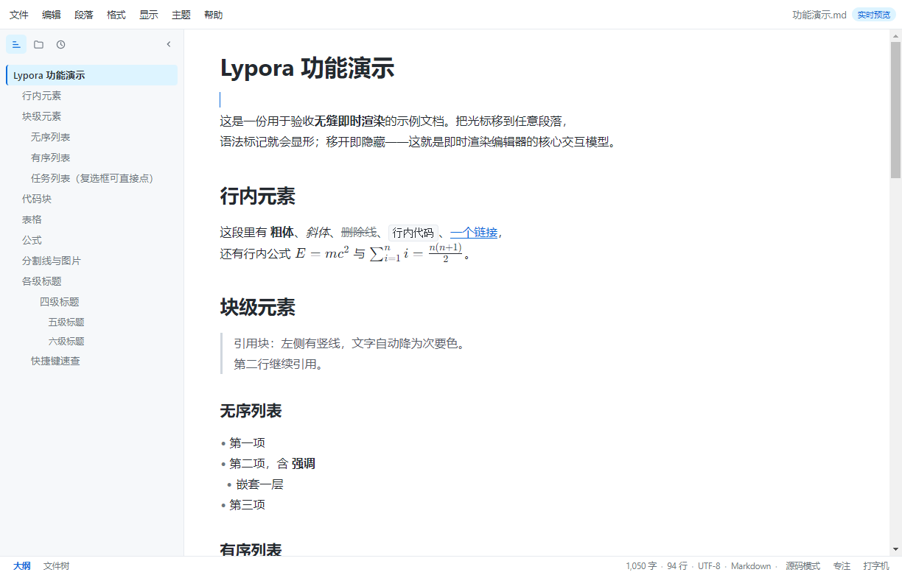

# Lypora

**An instant-render Markdown editor for Windows, the browser and Android — written in one TypeScript core.**

[English](#english) · [简体中文](#简体中文)



> **v0.4.0** — Windows x64 portable build, [`Lypora-0.4.0-win-x64.zip`](https://github.com/dr-bing-li/lypora/releases/download/v0.4.0/Lypora-0.4.0-win-x64.zip) · [all releases](https://github.com/dr-bing-li/lypora/releases)

---

## English

### What this is

Lypora is a live-preview Markdown editor. You type Markdown in the editor; as soon as the cursor leaves a
block it is rendered in place — headings look like headings, tables look like tables, formulas look like
formulas — and it turns back into plain source the moment you click into it. There is no side-by-side
"source / preview" split, and no rich-text round-trip that silently rewrites your file.

The whole thing is one TypeScript core (CodeMirror 6 + a small hand-written UI, no UI framework) wrapped by
three shells: an Electron desktop app, a browser/PWA build, and a Capacitor project for Android.

### Download

Latest: **[v0.4.0](https://github.com/dr-bing-li/lypora/releases/tag/v0.4.0)** · all builds on the
[Releases page](https://github.com/dr-bing-li/lypora/releases).

| File | Platform | Format | Size | SHA256 |
|---|---|---|---|---|
| [`Lypora-0.4.0-win-x64.zip`](https://github.com/dr-bing-li/lypora/releases/download/v0.4.0/Lypora-0.4.0-win-x64.zip) | Windows 10/11 x64 | Portable ZIP — unzip and run | 110.9 MiB | `adb223dd…cf911c2` |
| [`SHA256SUMS.txt`](https://github.com/dr-bing-li/lypora/releases/download/v0.4.0/SHA256SUMS.txt) | any | Checksum list | 409 B | — |

Unzip, keep the `Lypora\` folder intact, and run `Lypora\Lypora.exe`. No installer, no admin rights, no
auto-update — upgrading means downloading the next ZIP over it. **The executable is not code-signed**, so
SmartScreen will warn once ("More info" → "Run anyway").

Only Windows x64 is built and tested. macOS, Linux and an `.msi`/`.exe` installer are **not** shipped —
see the [platform matrix](https://github.com/dr-bing-li/lypora/releases/tag/v0.4.0) for why, rather than
publishing a package that downloads but does not run. The browser build and the Android project are built
from source (below).

Verify before running:

```bat
certutil -hashfile Lypora-0.4.0-win-x64.zip SHA256
```

### Why it exists (and what it is not)

Lypora is a **small, deliberately unambitious stand-in** for a much better product. It was built for one
practical reason: a convenient, no-install editor that is available immediately on a machine where the real
thing is not installed, not licensed, or not reachable.

It is **not** a replacement for Typora, and it is not trying to be. Think of it as a temporary seat
filler — good enough to open a `.md` file, edit it comfortably, and export it, while you wait to get back to
your real tools.

It is also, frankly, **vibe coded**: the project was built almost entirely by describing intent to an AI and
iterating on the result. That approach is great for coverage and terrible for consistency — you will find
uneven abstractions, comments that explain the wrong thing, and corners cut where nobody was looking. Treat
the code as a working draft, not as a reference implementation.

### Features

| Area | What you get |
|---|---|
| Rendering | Headings, bold/italic/strikethrough, inline code, links, images, blockquotes, ordered/unordered/task lists, fenced code with highlighting, tables, rules, KaTeX inline & block math, Mermaid diagrams |
| Editing | Seamless block/inline source toggle, clickable task checkboxes, list continuation, smart Enter, Tab indent, formatting shortcuts, find & replace, undo/redo, drag-and-drop open / image insert / theme import |
| Typography | `Ctrl` + mouse wheel for continuous font sizing (10–40 px, 300 ms debounce before persisting), on-screen `px · %` indicator, `Ctrl+Shift+=` / `Ctrl+-` stepping, `Ctrl+Shift+0` reset |
| Tables | Column dividers appear on hover with a `col-resize` cursor; drag to resize adjacent columns live, double-click to even them out. Column widths are stored locally by header signature and never touch your Markdown |
| Layout | 7 top-level menus with submenus, sidebar with outline / file tree / recent, source mode, focus mode, typewriter mode, full screen, adjustable page width (620 / 860 / 1080 / full / custom, or drag the handle) |
| Files | Open / save / save-as, recent files, workspace tree, export to Markdown / single-file HTML / PDF (KaTeX CSS and fonts are inlined, so exports render correctly offline) |
| Desktop | Native dialogs, single-instance lock, close-with-unsaved-changes guard, file association |

### Quick start

Requires **Node.js ≥ 20**.

```bash
# 1. build the core
cd core
npm install
npm run typecheck
npm run build          # -> core/dist

# 2. run it locally
npm run preview        # http://127.0.0.1:4173
```

### Deployment

**A. Browser / PWA (any static host)**

```bash
cd core && npm run build
# upload the contents of core/dist to GitHub Pages, Netlify, Cloudflare Pages,
# an nginx directory, or anything else that serves static files
```

`core/dist` is a plain static bundle with a service worker and a web manifest — no server-side routing and no
backend required. Serving it over HTTPS gives you installable PWA behaviour and offline caching.

**B. Windows portable build**

```bash
node tools/pack-win.mjs --zip
# -> release/Lypora/Lypora.exe           double-click to run
# -> release/Lypora-0.4.0-win-x64.zip    ready to hand out
```

Requires `desktop/node_modules/electron/dist` (`npm install` inside `desktop/` downloads it). The packer also
stamps the icon and version metadata into the executable.

**C. Android (APK included)**

```bash
node tools/build-android.mjs
# -> release/Lypora-0.4.0-android.apk    install with: adb install -r <file>
```

Needs **JDK 21** and an **Android SDK** with platform 35 + build-tools 35 — the script locates `ANDROID_HOME`
and a JDK ≥ 21 by itself and fails loudly (with the missing piece named) if it can't. The Capacitor project
lives in `core/android`, the touch shell in `core/src/ui/mobile.ts`; packaging notes in
[`android/README.md`](android/README.md).

The shipped APK is **debug-signed**: it installs on any device, but Google Play needs a release keystore.
Minimum **Android 10 (API 29)**, target **API 35**.

**D. Edge `--app` fallback**

If you want a window without the browser chrome on a machine without a packaged build, run `desktop/app.cjs`
as described in [`desktop/README.md`](desktop/README.md).

### Verifying it works

```bash
cd core
node verify.mjs            # 15 UI assertions + screenshots (needs `npm run preview` running)
node export-check.mjs      # export path: HTML / @media print / real PDF / print iframe

node mobile-check.mjs      # touch shell: 5 viewports, tap targets, drawer, menu sheet
node ../tools/closetest.mjs --exe        # window-close guard, four scenarios
node ../tools/interacttest.mjs           # real mouse events against the packaged build
env -u ELECTRON_RUN_AS_NODE ./release/Lypora/Lypora.exe --selftest --shot=shot.png
```

Details, measured numbers and the list of traps we hit are in [`docs/04-验证方案.md`](docs/04-验证方案.md).

### A tribute, and a disclaimer

**Typora is a genuinely excellent product.** Its focus mode, its inline-math editing, its typography and its
restraint are the reason this project exists at all: Lypora is an attempt to keep that way of writing
available in places where Typora itself cannot run. If you can use Typora, use Typora — it is better than
this, in every dimension that matters.

To be explicit about the obvious: **Lypora is a clumsy imitation of Typora.** It copies the *idea* of a
seamless live-preview editor, nothing else. Specifically:

- No Typora code, CSS, icon, font, theme or screenshot is included in this repository. Every line of
  TypeScript and CSS here was written from scratch; the icons are original.
- Lypora is **not affiliated with, endorsed by, or supported by** Typora or its developers. "Typora" is a
  trademark of its respective owner and is used here only to refer to that product, descriptively.
- Compatibility is limited to *behaviour and habits* — keyboard shortcuts, the shape of the interaction, the
  general look of a rendered document. If you believe something here crosses a line, please open an issue and
  it will be removed.

### Feedback

Bug reports, feature requests and blunt criticism are all welcome — especially "this is worse than Typora
because…", which is the most useful kind of feedback this project can get.

- Open an issue for anything reproducible (the file that breaks it, plus what you expected).
- Pull requests are welcome for small, self-contained fixes. Large rewrites will probably be declined — not
  because the idea is bad, but because this codebase is held together with duct tape and rewriting it
  properly is a different project.
- Please do not submit Typora theme files, icons or code snippets. Themes written by third parties may carry
  their own licences and are not ours to redistribute.

The full ground rules (and the commands to run before opening a PR) are in [`CONTRIBUTING.md`](CONTRIBUTING.md).

### Licence

[MIT](LICENSE), Copyright (c) 2026 dr-bing-li.

Third-party components and their licences are listed in [`THIRD-PARTY-NOTICES.md`](THIRD-PARTY-NOTICES.md).
All runtime dependencies (CodeMirror 6, Lezer, KaTeX) are MIT. Electron bundles Chromium, whose licence text
ships inside the built app as `LICENSES.chromium.html`.

The compliance review behind these decisions — dependency audit, asset provenance, trademark boundaries and
remaining risks — is documented in [`docs/05-开源合规说明.md`](docs/05-开源合规说明.md).

---

## 简体中文

### 这是什么

Lypora 是一个即时渲染的 Markdown 编辑器。你在编辑区里写 Markdown，光标离开某个块，块就按最终样式渲染
出来——标题长得像标题，表格长得像表格，公式长得像公式——光标点回去又变回源码。没有左源码右预览的分栏，
也没有「转成富文本再序列化回来」的往返损耗。

整套东西是一个 TypeScript 核心（CodeMirror 6 + 手写 UI，不用 UI 框架），外面套三层壳：Electron 桌面版、
浏览器 / PWA 版、Capacitor 的 Android 工程。

### 下载

最新版本：**[v0.4.0](https://github.com/dr-bing-li/lypora/releases/tag/v0.4.0)** · 全部构建见
[Releases 页面](https://github.com/dr-bing-li/lypora/releases)。

| 文件 | 平台 | 格式 | 大小 | SHA256 |
|---|---|---|---|---|
| [`Lypora-0.4.0-win-x64.zip`](https://github.com/dr-bing-li/lypora/releases/download/v0.4.0/Lypora-0.4.0-win-x64.zip) | Windows 10/11 x64 | 便携版 ZIP，解压即用 | 110.9 MiB | `adb223dd…cf911c2` |
| [`SHA256SUMS.txt`](https://github.com/dr-bing-li/lypora/releases/download/v0.4.0/SHA256SUMS.txt) | 任意 | 校验清单 | 409 B | — |

解压后**保持 `Lypora\` 文件夹结构完整**，双击 `Lypora\Lypora.exe` 即可。无安装程序、无需管理员权限、
没有自动更新——升级就是下载新版 ZIP 覆盖上去。**exe 未做代码签名**，所以 SmartScreen 会拦一次：
「更多信息」→「仍要运行」。

只有 Windows x64 是构建并测试过的。macOS、Linux、`.msi` / `.exe` 安装包**均未提供**，原因写在
[平台矩阵](https://github.com/dr-bing-li/lypora/releases/tag/v0.4.0) 里：宁可不给，也不放一个「能下载但跑
不起来」的包。浏览器版与 Android 工程按下面的步骤自行构建。

运行前先校验：

```bat
certutil -hashfile Lypora-0.4.0-win-x64.zip SHA256
```

### 为什么会有这个东西（以及它不是什么）

Lypora 是一个**小小的、刻意不做大的替代品**，用来临时顶一顶。它诞生的理由很实际：在某台机器上，正主
没装、没授权、或者根本打不开的时候，能立刻有一个不用安装、能舒服改 Markdown 的地方。

它**不是** Typora 的替代品，也没打算成为替代品。请把它当成一把临时的椅子——能坐下、能打开一个 `.md`、
能改、能导出，等你回到自己的正经工具上，它就功成身退。

说得更直白一点：这个项目是 **vibe coding** 出来的——几乎全程靠向 AI 描述意图、看结果、再调整来推进。
这种方式铺功能很快，做一致性很糟。所以你会看到不平整的抽象、解释错方向的注释、以及没人盯着时被偷掉的
角落。请把代码当成一份草稿，不要当成参考实现。

### 功能

| 方面 | 内容 |
|---|---|
| 渲染 | 标题、粗体 / 斜体 / 删除线、行内代码、链接、图片、引用、有序 / 无序 / 任务列表、围栏代码（语法高亮）、表格、分割线、KaTeX 行内与块公式、Mermaid 图表 |
| 编辑 | 块级 / 行内源码双态无缝切换、可勾选任务框、列表自动续行、智能回车、Tab 缩进、格式化快捷键、查找替换、撤销重做、拖放打开 / 插图 / 导入主题 |
| 字号 | `Ctrl` + 滚轮连续平滑调字号（10–40px，停手 300ms 才落盘），浮层实时显示 `px · 百分比`；`Ctrl+Shift+=` / `Ctrl+-` 步进、`Ctrl+Shift+0` 复位 |
| 表格 | 悬停列间隔出现 `col-resize` 光标，拖动实时调整相邻两列宽度，双击均分；列宽按表头签名记在本地，不写进 Markdown |
| 版式 | 7 个顶级菜单（含二级）、左侧栏大纲 / 文件树 / 最近、源代码模式、专注模式、打字机模式、全屏、页面宽度可调（620 / 860 / 1080 / 全宽 / 自定义，或拖右边缘把手） |
| 文件 | 打开 / 保存 / 另存、最近文件、工作区文件树、导出 Markdown / 单文件 HTML / PDF（KaTeX 的 CSS 与字体内联，离线打开公式也是对的） |
| 桌面 | 原生对话框、单实例、关窗前未保存拦截、文件关联 |

### 快速开始

需要 **Node.js ≥ 20**。

```bash
# 1. 构建核心
cd core
npm install
npm run typecheck
npm run build          # -> core/dist

# 2. 本地跑起来
npm run preview        # http://127.0.0.1:4173
```

### 部署

**A. 浏览器 / PWA（任意静态托管）**

```bash
cd core && npm run build
# 把 core/dist 里的内容传到 GitHub Pages、Netlify、Cloudflare Pages，
# 或者丢进 nginx 的一个目录，都行
```

`core/dist` 是纯静态产物，自带 Service Worker 和 web manifest，不需要服务端路由，也不需要后端。用 HTTPS
提供服务即可获得可安装的 PWA 与离线缓存。

**B. Windows 便携版**

```bash
node tools/pack-win.mjs --zip
# -> release/Lypora/Lypora.exe           双击即用
# -> release/Lypora-0.4.0-win-x64.zip    可直接分发
```

依赖 `desktop/node_modules/electron/dist`（在 `desktop/` 里 `npm install` 会下载）。打包脚本会把图标和
版本信息写进 exe。

**C. Android（已附带 APK）**

```bash
node tools/build-android.mjs
# -> release/Lypora-0.4.0-android.apk    安装：adb install -r <文件>
```

需要 **JDK 21** 与 **Android SDK**（platform 35 + build-tools 35）。脚本会自己找 `ANDROID_HOME` 和 ≥21 的
JDK，缺什么就报什么。Capacitor 工程在 `core/android`，触屏外壳在 `core/src/ui/mobile.ts`，
打包细节见 [`android/README.md`](android/README.md)。

提供的 APK 是 **debug 签名**：任何设备可直接安装，但上架 Google Play 需要 release keystore 重新签名。
最低支持 **Android 10（API 29）**，target **API 35**。

**D. Edge `--app` 兜底**

没打安装包、又想要一个没有浏览器工具栏的窗口时，按 [`desktop/README.md`](desktop/README.md) 里的说明跑
`desktop/app.cjs`。

### 怎么证明它没坏

```bash
cd core
node verify.mjs            # 15 步 UI 断言 + 截图（需先 npm run preview）
node export-check.mjs      # 导出链路：HTML / @media print / 真 PDF / 打印 iframe

node mobile-check.mjs      # 触屏外壳：5 种视口、点击区、抽屉、菜单面板
node ../tools/closetest.mjs --exe        # 关窗拦截四场景
node ../tools/interacttest.mjs           # 对打包版派发真实鼠标事件
env -u ELECTRON_RUN_AS_NODE ./release/Lypora/Lypora.exe --selftest --shot=shot.png
```

细节、实测数字和踩过的坑都在 [`docs/04-验证方案.md`](docs/04-验证方案.md)。

### 致敬与免责

**Typora 确实是个很好的产品。** 它的专注模式、行内公式编辑、排版和克制，是这个项目存在的全部理由：
Lypora 想做的是，把那种写作方式搬到 Typora 自己跑不了的地方去。能用 Typora 就用 Typora——它在每一件
要紧的事上都比这个好。

把话说透：**Lypora 完全是对 Typora 的拙劣模仿。** 它抄的只是一个「无缝即时渲染编辑器」的念头，别的没了。
具体地：

- 仓库里不包含 Typora 的任何代码、CSS、图标、字体、主题或截图。这里每一行 TypeScript 和 CSS 都是从零
  写的，图标是原创的。
- Lypora 与 Typora 及其开发者**没有任何关联**，也不代表其认可或支持本项目。"Typora" 是其权利人的商标，
  此处仅用于指称该产品本身，属描述性使用。
- 所谓兼容，只到「行为与习惯」这一层——快捷键、交互形状、渲染出来的大致观感。如果你认为某处越过了界线，
  请开 issue 指出，我会删掉它。

### 反馈

欢迎 bug 报告、功能请求，以及直白的批评——尤其是「这里比 Typora 差，因为……」这种，那是对这个项目最有
用的反馈。

- 能复现的问题请直接开 issue（附上出问题的文件和你的预期）。
- 小而独立的修复欢迎提 PR。大改大重构大概会被拒——不是想法不好，而是这个代码库是靠胶带粘起来的，正经
  重写属于另一个项目。
- 请不要提交 Typora 的主题文件、图标或代码片段。第三方主题可能有自己的许可证，我没有权利转分发。

提 PR 前的检查命令与完整规则见 [`CONTRIBUTING.md`](CONTRIBUTING.md)。

### 许可证

[MIT](LICENSE)，Copyright (c) 2026 dr-bing-li。

第三方组件与其许可证见 [`THIRD-PARTY-NOTICES.md`](THIRD-PARTY-NOTICES.md)：运行期依赖（CodeMirror 6 /
Lezer / KaTeX）全部为 MIT；Electron 内含 Chromium，其许可证文本随包保留为 `LICENSES.chromium.html`。

上述决定背后的合规审查——依赖审计、素材来源、商标边界与残余风险——记录在
[`docs/05-开源合规说明.md`](docs/05-开源合规说明.md)。
